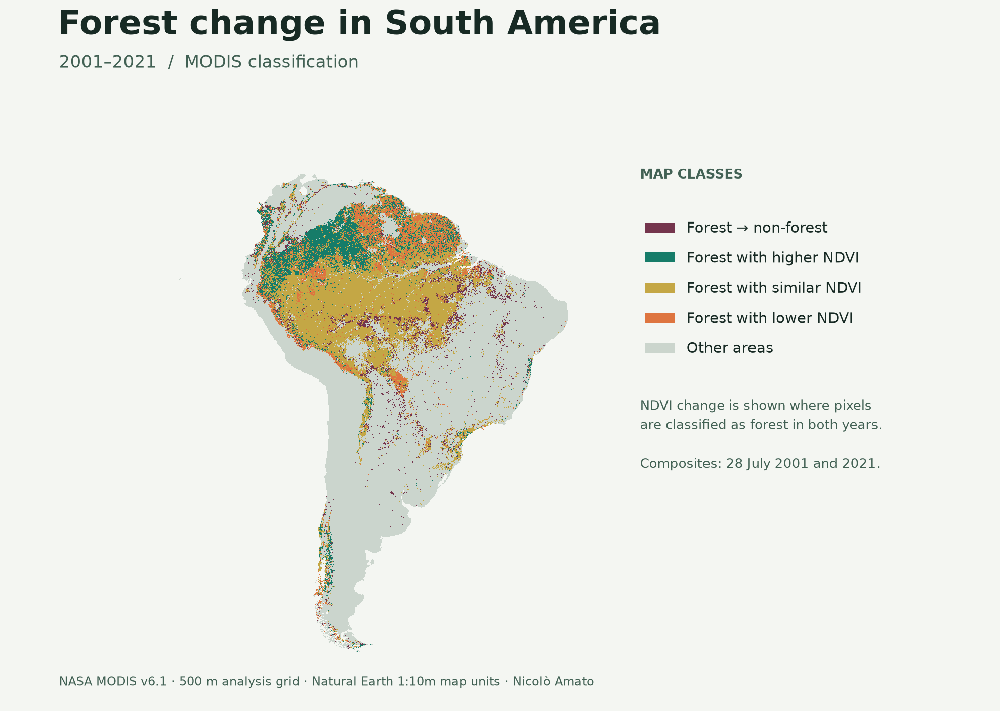
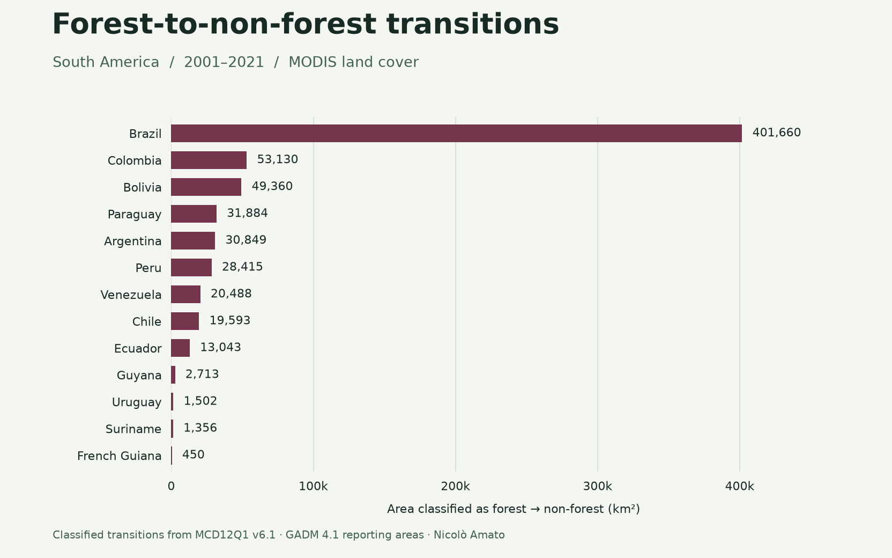
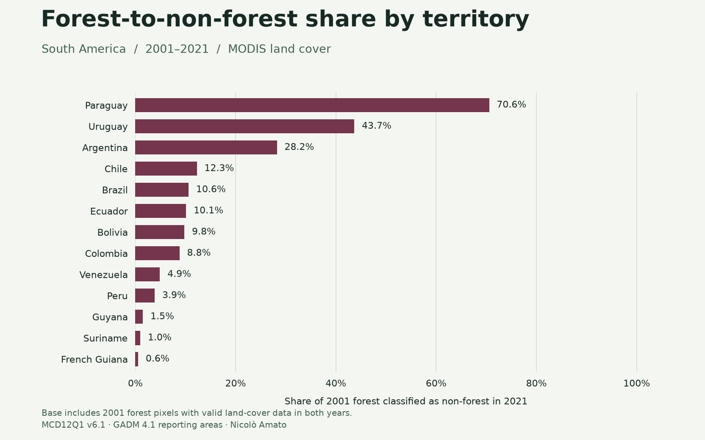
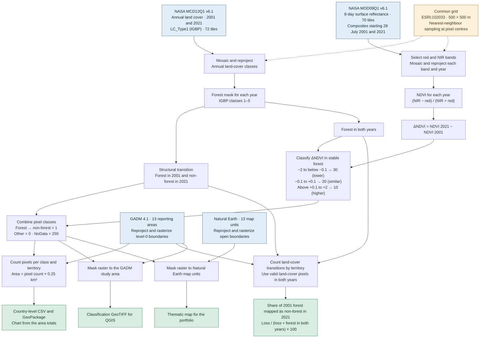

# Forest change in South America, 2001–2021

[](LICENSE)
[](https://changelog.qgis.org/en/qgis/version/3.40/)

A university geoinformatics project by **Nicolò Amato** for *Tecnologie per la Geoinformatica*. The analysis uses 142 MODIS tiles to classify forest-to-non-forest transitions and measure NDVI change where pixels are classified as forest in both years. The workflow uses a common 500 m equal-area grid. Python runs the analysis and exports layers for QGIS.



*The map uses Natural Earth boundaries. The area statistics use GADM 4.1 reporting areas.*

## Results

The analysis classified **654,442.25 km²** as forest in 2001 and non-forest in 2021. Brazil accounted for **401,659.75 km²** in this class.

| Class | Area (km²) |
| --- | ---: |
| Forest → non-forest | 654,442.25 |
| Forest in both years, higher NDVI | 1,253,400.25 |
| Forest in both years, similar NDVI | 3,912,058.50 |
| Forest in both years, lower NDVI | 1,062,933.75 |



### Share of the 2001 forest area

The percentage uses the area classified as forest in 2001 with valid land-cover data in both years. Brazil leads by area in km². Paraguay has the highest share of its 2001 forest classified as non-forest in 2021, at **70.6%**.



See the [results by territory](results/forest_change_by_country.csv), the [land-cover transition counts](results/forest_transitions_by_country.csv) and the [run metadata](results/run_metadata.json).

## Workflow from inputs to results

Use the Mermaid controls on GitHub to zoom, expand and move around the diagram.



See the [methodology](docs/workflow.md) for class definitions, missing-data rules and output checks.

## Run the analysis

[](pyproject.toml)

Install [uv](https://docs.astral.sh/uv/) and run these commands from the repository root:

```sh
uv sync --locked
uv run forest-change login
uv run forest-change reproduce
uv run forest-change compare
```

Earthdata Login is required for the MODIS download, which is about 4.7 GB. The login command saves credentials locally. You can also use an existing `~/.netrc` or the `EARTHDATA_TOKEN` environment variable. Use `--workers 1` to reduce memory use.

The analysis writes a colour-indexed GeoTIFF, a GeoPackage, the area and transition tables, and metadata under `data/output/`. Add the GeoTIFF and GeoPackage as layers in QGIS to inspect the outputs. The `compare` command compares the local run with the published counts. See the [workflow documentation](docs/workflow.md#regenerate-the-figures) to render the map and charts.

## Interpretation

Forest → non-forest denotes a change in IGBP class between the two snapshots. The MODIS product team advises against interpreting annual class differences alone as real land-cover change, because the labels can vary between years. The NDVI classes describe greenness differences between two 8-day composites and are sensitive to seasonality and observation quality. [MCD12Q1 v6.1 user guide](https://lpdaac.usgs.gov/documents/1409/MCD12_User_Guide_V61.pdf)

## Data sources and license

- NASA MODIS land cover [MCD12Q1 v6.1](https://doi.org/10.5067/MODIS/MCD12Q1.061)
- NASA MODIS surface reflectance [MOD09Q1 v6.1](https://doi.org/10.5067/MODIS/MOD09Q1.061)
- GADM 4.1 reporting areas [GADM terms of use](https://gadm.org/license.html). Boundary files and the generated GeoPackage stay local.
- Natural Earth 1:10m Admin 0 map units [Natural Earth terms of use](https://www.naturalearthdata.com/about/terms-of-use/).

The project code and documentation are available under the [MIT License](LICENSE). Third-party data retain their respective terms.
